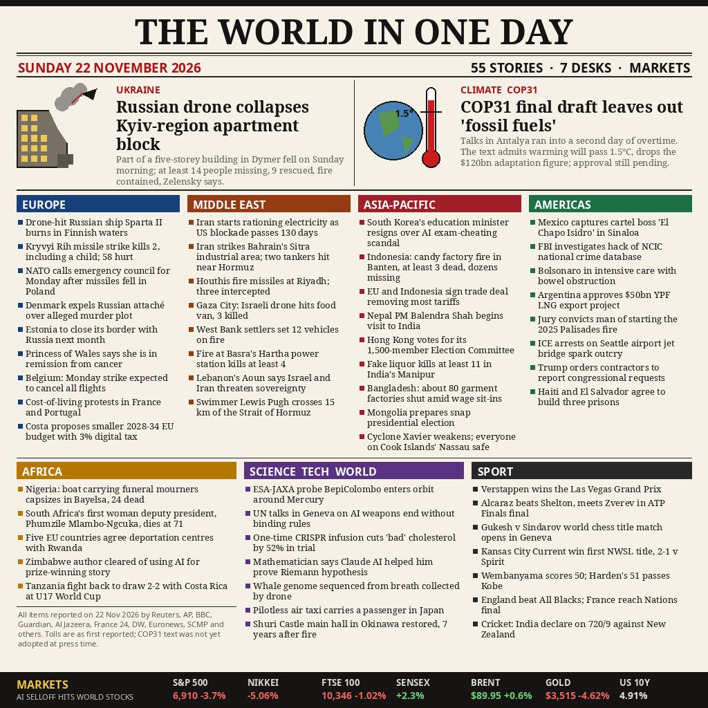

# The World in One Day — Sunday 22 November 2026

[](https://make.fun/bounty/news-image-20261122)
[](https://make.fun/bounty/news-image-20261122)
[](https://make.fun/bounty/news-image-20261122)

Entry for the make.fun bounty **news-image-20261122**: the world's news of 22 November 2026 in one broadsheet page.



- 55 stories in 7 desks (Europe, Middle East, Asia-Pacific, Americas, Africa, Science/Tech/World, Sport), two lead stories (Kyiv-region drone strike, COP31 final draft) and a markets strip.
- `stories.py` holds the text, `build.py` renders `entry.png` (1024×1024 PNG) with Pillow; the render is deterministic.
- `main.py` (Python 3.13, standard library only) copies `entry.png` to `/output/entry.png`.

Local test:

```sh
mkdir -p out && MAKEFUN_OUTPUT_DIR=out python3 main.py && cmp out/entry.png entry.png
```

License: MIT.
